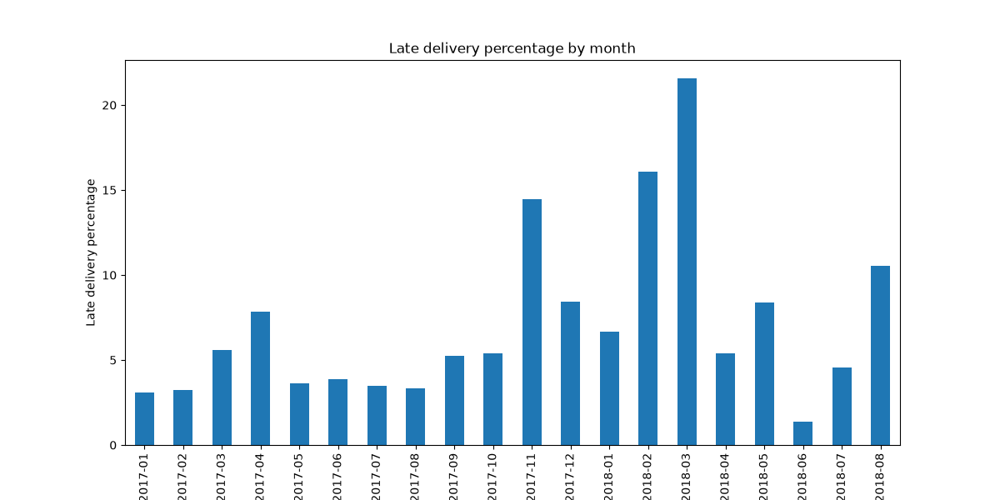
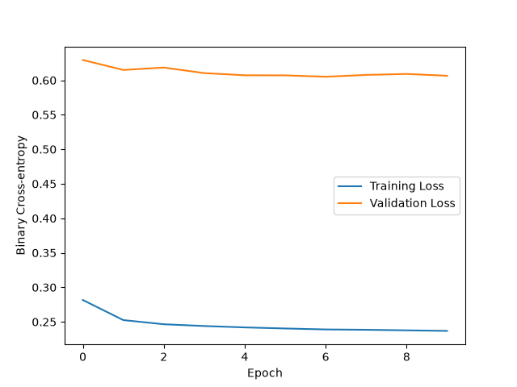
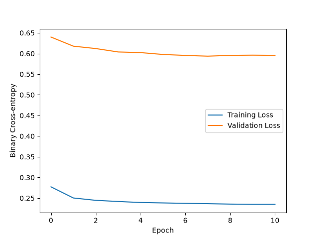

# Olist Late Delivery Prediction (SQL + Python)

This project extends my [Olist SQL analysis](https://github.com/PedroAraigiH/olist-sql-analysis), where late orders were found to damage review scores. I designed machine learning models using logistic regression, gradient boosting, and MLP neural network to predict if the orders will be delivered late. The months studied are the same : from January 2017 till August 2018 (94931 single-seller orders) since the months outside that range had too few orders. Gradient boosting did best (ROC AUC 0.718 versus 0.5 for random). The neural network did not beat simpler models, and seller history did not help.

- Data: [Brazilian E-Commerce Public Dataset by Olist (Kaggle)](https://www.kaggle.com/datasets/olistbr/brazilian-ecommerce)
- Tools: SQLite, SQL (CTEs, joins), Python (sqlite3, pandas, matplotlib, scikit-learn, tensorflow)
- Full pipeline with all numbers and decisions: [analysis.ipynb](analysis.ipynb)

## Setup

- An order is late if it is delivered after the estimated date. The goal of this project is to predict when orders might be late.
- Predictions are made at purchase time, with only features known then (no delivery dates or reviews included in the features).
- A buffer month was left outside the train/test sets to prevent leakage since orders delivery can sometimes take up to a month. Whether an order is late is only known after delivery.
- The model's success is measured based on ROC AUC and PR AUC instead of accuracy since 93.7% of test orders arrive on time.

## Key findings

### Part 1 : baseline features
1. I divided the 20 months interval into a training period (before April 2018, 15 months), a buffer (The month of April 2018), and a test period (from May 2018). Late orders were found to be more frequent in the training set with a share of 9.3%, while the test set had only 6.3%.

2. I tested two main models: Logistic regression, which resulted in a ROC AUC of 0.704; and gradient boosting, which got a ROC AUC of 0.718, slightly higher than the logistic regression. Both models had a PR AUC of 0.130.

3. After implementing a Multilayer Perceptron composed of two hidden layers (32 and 16 neurons, with 20% dropout) and a one neuron output layer, the average of three seeds had a ROC AUC of 0.639, and  a PR AUC of 0.097. These values are lower than both previous models. In addition, the validation loss stayed much higher than the training loss.

### Part 2 : with seller history
4. In this second section, I tried to improve the models' results by adding sellers history to the features. However, this made all three models worse.

| Model | Baseline ROC AUC | Baseline PR AUC | Seller history ROC AUC | Seller history PR AUC |
|---|---:|---:|---:|---:|
| Random | 0.500 | 0.063 | 0.500 | 0.063 |
| Logistic regression | 0.704 | 0.130 | 0.674 | 0.123 |
| Gradient boosting | 0.718 | 0.130 | 0.704 | 0.123 |
| MLP (average of 3 seeds)| 0.639 | 0.097 | 0.620 | 0.090 |

5. My assumption is that lateness is mostly caused by events that hit all sellers, not only habitually slow ones. The Black Friday and the February-March delays are such examples. In the end, the original feature set without seller history was chosen as a final model.

| features | LR ROC | LR PR | GB ROC | GB PR |
|---|---|---|---|---|
| no seller features | 0.704 | 0.130 | 0.718 | 0.130 |
| rate only | 0.696 | 0.137 | 0.722 | 0.135 |
| rate + orders | 0.674 | 0.123 | 0.704 | 0.123 |
| no month | 0.701 | 0.128 | 0.655 | 0.100 |

LR = logistic regression, GB = gradient boosting. "rate" is the seller’s past late rate, "orders" is the number of past orders.

From the table we can see that the number of past orders hurt, the rate alone was about neutral, and removing month hurt gradient boosting a lot. In training, orders from sellers with a worse history are more often late (7.4% to 11.4%). In the test period the late rate is almost flat (6.0% to 6.6%) (see analysis.ipynb). 

## Next steps
- Adding features that are not used here, such as the real distance between seller and customer, and the carrier, or the seller's workload.
- Compute the seller history on a recent window, such as the last 30 days, since the all time rate was slow to adapt.
- Evaluate with several time based splits (rolling windows), not a single test period.

## Limitations
- Only 20 months of data, so seasonality and one-off events can't be separated. Also, the late rate changes a lot between train, validation, and test.
- Only single seller orders (about 98.7%) are used, and the results show association, not causes.
- The MLP uses one architecture without tuning, so different setup might do better.

## How to run
1. Install requirements by running : `pip install -r requirements.txt`
2. Download the dataset from Kaggle and put the CSV files in `data/raw/`.
3. Run `python load_db.py` to build the SQLite database.
4. Run `analysis.ipynb` from top to bottom (it uses sql/orders_dataset.sql for Part 1 and sql/orders_dataset2.sql for Part 2).

Tested with Python 3.12.15 and TensorFlow 2.21.0 . TensorFlow only supports certain Python versions, see the [TensorFlow installation page](https://www.tensorflow.org/install/pip).